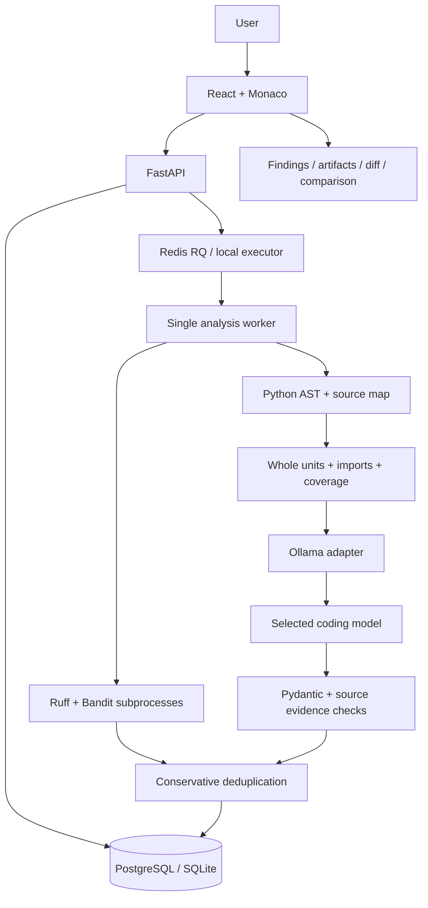
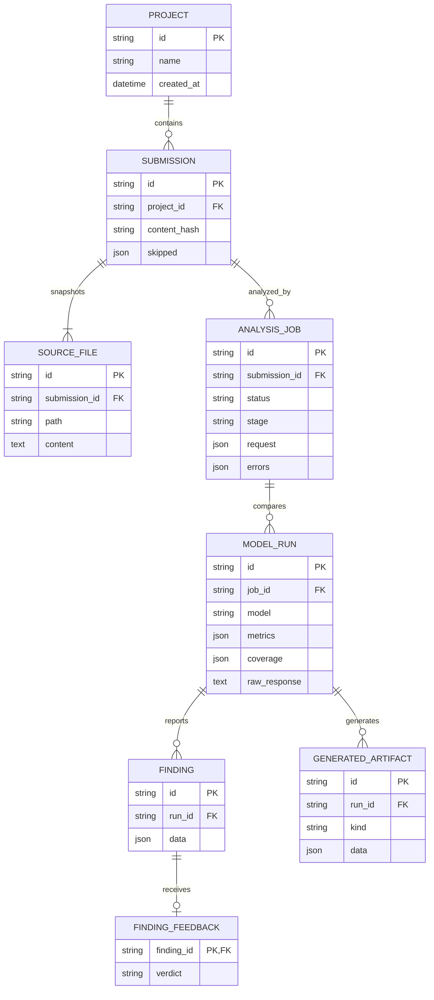

# Architecture

CodeLens is a modular monolith with a background worker. The frontend uses React,
TypeScript, Tailwind and a locally bundled Monaco editor. FastAPI owns validation,
storage and APIs; the worker composes isolated static analyzers and Ollama inference.
SQLAlchemy supports PostgreSQL in Compose and SQLite in native demonstration mode.

## Components

## Request lifecycle

`POST /projects/{id}/submissions` or `/uploads` validates content and persists an
immutable snapshot. Its SHA-256 covers sorted paths and source content. An analysis
request creates an `AnalysisJob`, returns HTTP 202 with its ID, and queues work.

The worker parses source, runs static tools when applicable, selects context and
calls each selected model sequentially. Review prompts are identical across models.
Hybrid combines independent static and AI results after inference, preserving an
AI-only baseline for evaluation. It does not inject static tool diagnoses into
the model prompt. Results are validated and committed per model run; the API polls
the durable job status. Artifacts use the same queue and provider but a separate
schema and task-specific instruction.

## Domain modules

| Module | Responsibility |
|---|---|
| `config.py` | Environment-backed settings and allowed model tags |
| `db.py` | SQLAlchemy entities, database sessions and SQLite pragmas |
| `schemas.py` | Request and model-response contracts |
| `ingestion.py` | Filename/archive limits, UTF-8 checks, snapshot hashing |
| `context.py` | AST symbols, signatures, context units, original line maps |
| `analysis.py` | Real analyzer adapters, evidence checks, deduplication |
| `prompts.py` | Versioned system and task instructions |
| `provider.py` | Model-provider protocol and Ollama HTTP adapter |
| `jobs.py` | Queue integration, orchestration, persistence and failure handling |
| `main.py` | REST endpoints, lifecycle, readiness and report export |

## Entity relationships

JSON stores variable provider metrics and schema-validated finding/artifact payloads;
identity, ownership and relationships remain normalized. Cascading foreign keys
remove project-owned data. Alembic migration 0001 creates the schema explicitly.

## Job and failure semantics

`queued -> running -> completed | partial | failed`

- Completed means the requested processing finished, not that code is bug-free.
- Partial means some useful processing completed but an analyzer/model failed or
  model context omitted source. Coverage must be inspected alongside findings.
- Failed means the requested result could not be produced.
- Native restart invalidates queued/running jobs. Stale jobs expire on polling.
- Completed jobs are idempotent; an interrupted run can replace incomplete results.
- Provider schema repair runs at most once. Other retries are explicit new jobs.
- Parallel inference is intentionally disabled in the provided deployment.

## Evidence and trust boundary

Submitted source is data only. Static tools run via argument arrays in temporary
directories; Python is never imported or executed. Ruff uses isolated settings;
Bandit sees only accepted Python source. Models receive delimited source context,
no credentials, shell, tools or authority to mutate projects. Prompts reduce but
cannot eliminate prompt-injection influence on generated prose.

Each finding is labeled `evidence_matched`, `unsupported_evidence`, or
`invalid_location`. Matching evidence does not establish semantic correctness. A
finding may be a false positive even when its location is valid. User feedback and
the evaluation protocol address this gap.

Proposed code is parsed with `ast.parse`, never run. Unified diffs are computed
locally from the stored original and returned proposal. React escapes finding text;
Markdown rendering skips raw HTML. A remote Ollama URL is administrator configuration,
not an arbitrary URL supplied by the browser.

## Deliberate tradeoffs

1. No vector database: deterministic AST units are sufficient for small projects.
2. No microservices: a student team can understand and test the whole pipeline.
3. No autonomous patch application: changes need human verification.
4. No model-specific accuracy assumptions: model selection is measured locally.
5. Native SQLite fallback: core functionality remains runnable without Docker.
6. Conservative merging: distinct diagnoses on the same line remain separate.

The principal extension points are `ModelProvider`, analyzer adapters and task
prompts. Future work can add a call graph, more languages, authenticated teams,
human-adjudicated real bug datasets and genuinely isolated test execution.
